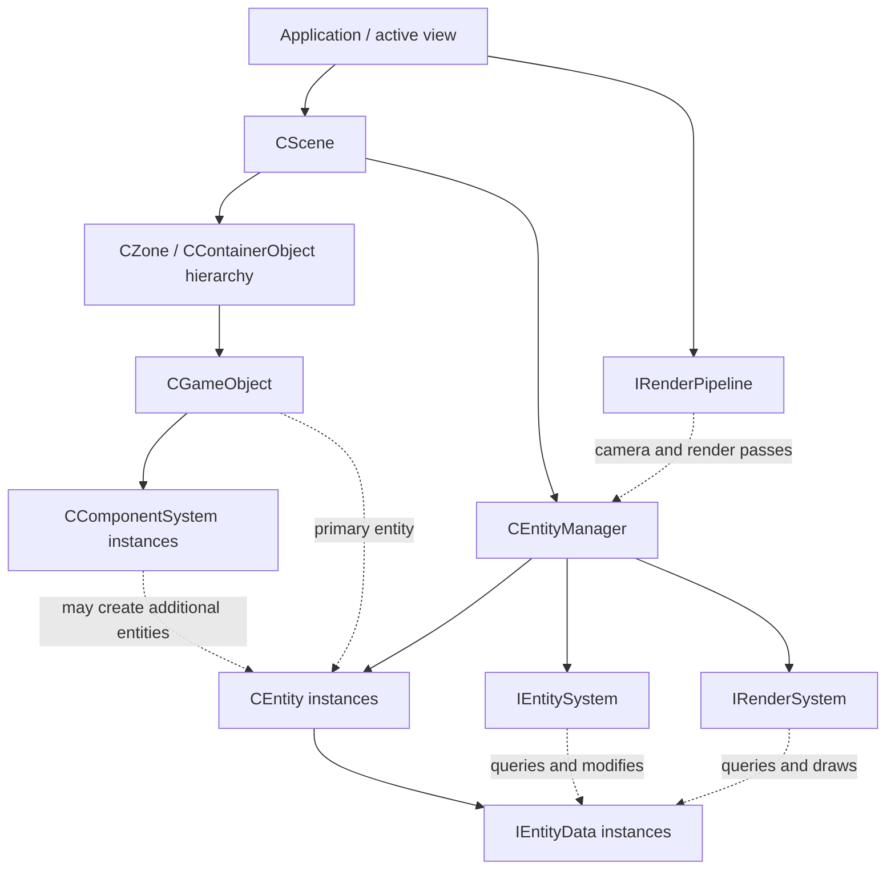

# Skylicht Runtime Architecture

This guide explains how to structure an application built on Skylicht Engine: scene ownership, GameObject components, entity data, simulation systems, and rendering. It complements [Setup.md](Setup.md), which covers standalone application setup.

The behavior described here was checked against the engine source in this checkout and informed by a production game using it. Examples use generic application types and require no private project code, assets, or services. Source links refer to this engine checkout; check them again when upgrading the engine.

## 1. The two connected layers

Skylicht combines an object/component hierarchy with an entity data processing layer. They share runtime state through entities and transform data.



Arrows show structural relationships or execution dependencies, not uniformly exclusive ownership. For example, a GameObject refers to its primary entity, but the entity manager allocates and recycles that entity.

| Type | Responsibility | Typical application use |
| --- | --- | --- |
| `CScene` | Owns zones and one entity manager | One loaded world or independently managed scene |
| `CZone` / `CContainerObject` | Organizes objects and child hierarchies | World roots, environment groups, nested objects |
| `CGameObject` | Named object with components, transform access, and a primary entity | Camera, player controller, effect host, level object |
| `CComponentSystem` | Behavior attached to one GameObject | Setup, editor properties, object lifecycle, input bridge |
| `CEntity` | Indexed container of typed data slots | Render instance, model node, simulated agent |
| `IEntityData` | State attached to an entity | Transform, mesh, velocity, lifetime, health |
| `CEntityGroup` | Cached selection of entities with required data | All agents, all timed effects, visible meshes |
| `IEntitySystem` | Processes matching entity data | Movement, targeting, timers, animation logic |
| `IRenderSystem` | Entity system with render callbacks | Culling, mesh rendering, custom effects |
| `IRenderPipeline` | Orchestrates camera rendering and passes | Forward, deferred, shadows, postprocessing |

A GameObject is not an entity, and a component is not entity data. A GameObject has a primary entity, while components such as mesh or primitive components can manage additional entities. Do not assume a one-to-one relationship between objects and all rendered entities.

## 2. Scene and object lifecycle

Create a scene, then a zone, then objects through the zone/container APIs:

```cpp
CScene* scene = new CScene();
CZone* zone = scene->createZone();
CGameObject* cameraObject = zone->createEmptyObject();
CCamera* camera = cameraObject->addComponent<CCamera>();
```

The application owns `scene`. The scene creates its entity manager and installs built-in transform, animation, culling, lighting, and rendering systems. Application code normally registers only its additional systems.

Objects own their attached `CComponentSystem` instances. `addComponent<T>()` initializes the component through the GameObject path. Components can use `m_gameObject` to access their scene, entity manager, transform, and primary entity.

Despite its name, `CComponentSystem` is an object-level component; it is not an `IEntitySystem`. Its lifecycle includes `initComponent()`, `startComponent()`, `updateComponent()`, optional `endUpdate()`, and destruction. Follow the existing object startup and enable paths rather than manually invoking these callbacks.

Object additions/removals are staged by containers. Use `object->remove()` for an ordinary child object and `scene->removeZone(...)` for a zone. Do not delete scene-owned objects or manager-owned entities directly. The engine explicitly warns against forcing `scene->updateAddRemoveObject()` inside object/component updates; doing so can invalidate traversal. It can be useful while constructing a scene before normal updates begin.

Deleting the scene releases zones and objects before deleting the entity manager. A GameObject releases its components before queuing removal of its primary entity. Components that own extra entities must release them through their owning component/manager APIs.

## 3. Entity data and type registration

Entity data derives from `IEntityData`. Keep per-instance state here and place repeated processing in systems. Data can have constructors, destructors, and helper methods; Skylicht does not require plain POD structs.

A minimal application data type:

```cpp
// CLifetimeData.h
#pragma once
#include "Entity/IEntityData.h"

using namespace Skylicht;

class CLifetimeData : public IEntityData
{
public:
	float RemainingSeconds = 1.0f;
};

DECLARE_PRIVATE_DATA_TYPE_INDEX(CLifetimeData);
```

```cpp
// CLifetimeData.cpp
#include "pch.h"
#include "CLifetimeData.h"

IMPLEMENT_DATA_TYPE_INDEX(CLifetimeData);
```

Keep the declaration and implementation in the same namespace when using a project namespace. The example assumes the project's PCH supplies the normal engine declarations, as in the engine samples. Exported engine types use the public data-index declaration; application-local types normally use the private declaration.

Attach and access state:

```cpp
CEntity* entity = object->getEntity();
CLifetimeData* lifetime = entity->addData<CLifetimeData>();
lifetime->RemainingSeconds = 3.0f;

CLifetimeData* existing = GET_ENTITY_DATA(entity, CLifetimeData);
if (existing != NULL)
	existing->RemainingSeconds = 5.0f;
```

`GET_ENTITY_DATA` directly indexes `entity->Data[Type_DataTypeIndex]`. It does not check the entity pointer or whether the data exists. Validate the entity first and check optional data before dereferencing it.

`addData<T>()` creates a new instance and replaces any existing instance of that type, deleting the old one. It is not a get-or-create operation. Repeated attachment invalidates cached pointers and may run cleanup logic.

The current `CEntity` has `MAX_ENTITY_DATA = 64` slots. Type indices are runtime registrations, not persistent save identifiers. Do not serialize those numeric indices as stable application IDs, and account for engine and application data types together when extending the project.

### Creating entities without GameObjects

Use this for populations or instances that do not need individual object components. In this checkout, `CEntityManager::createEntity()` adds `CVisibleData`, but does not add transform data. The normal alive-entity sorting and visibility paths dereference `CWorldTransformData`, so add it before the next scene update:

```cpp
CEntityManager* manager = scene->getEntityManager();
CEntity* entity = manager->createEntity();
entity->addData<CWorldTransformData>();
entity->addData<CLifetimeData>();
```

Model, prefab, and primitive components usually perform additional initialization themselves. Prefer their creation APIs when creating their instances. Do not duplicate transform data on an entity that already has it.

## 4. Queries and simulation systems

Implement all four `IEntitySystem` callbacks:

| Callback | Intended use |
| --- | --- |
| `init(manager)` | One-time system initialization when registered |
| `beginQuery(manager)` | Obtain/create groups and prepare query state |
| `onQuery(manager, entities, count)` | Select entities or collect temporary data pointers |
| `update(manager)` | Process the selected state |

Register using `manager->addSystem<CMySystem>()`. Registration constructs the system, calls `init()`, and assigns an update order. The manager owns the returned system; do not delete it yourself. Registration first searches existing systems by compatible dynamic type, so ordinary repeated registration of the same concrete type returns the existing instance.

Create a group once, usually in `beginQuery()`, rather than every frame:

```cpp
void CLifetimeSystem::beginQuery(CEntityManager* manager)
{
	if (m_group == NULL)
	{
		const u32 types[] = GET_LIST_ENTITY_DATA(CLifetimeData);
		m_group = manager->createGroup(types, 1);
	}
}
```

Here `m_group` is a `CEntityGroup*` initialized to `NULL`. It is owned by the manager. A simple system can leave `init()` and `onQuery()` empty and process the group directly:

```cpp
void CLifetimeSystem::update(CEntityManager* manager)
{
	CEntity** entities = m_group->getEntities();
	int count = m_group->getEntityCount();
	float dt = getTimeStep() * 0.001f;

	for (int i = 0; i < count; ++i)
	{
		CEntity* entity = entities[i];
		if (!entity->isAlive())
			continue;

		CLifetimeData* data = GET_ENTITY_DATA(entity, CLifetimeData);
		if (data == NULL)
			continue;

		data->RemainingSeconds -= dt;
		if (data->RemainingSeconds <= 0.0f)
			manager->removeEntity(entity);
	}
}
```

These are system implementation fragments, not a complete source file. Declare `CLifetimeSystem : public IEntitySystem` and its four overrides in the corresponding header. This example removes only independently manager-owned entities. If an entity belongs to a GameObject or another component's instance collection, request removal through that owner so its pointers and collections stay consistent.

### Group semantics

- `createGroup(types, count)` selects entities containing all listed types.
- `createGroup(types, count, parent)` further filters a parent group's members. Create the parent before the child.
- `createGroupFromVisible(types, count)` uses the engine visibility group as parent. This includes inherited object visibility; it is not equivalent to a camera frustum test.
- `findGroup(types, count)` checks for groups containing the requested types. In this checkout it does not require an exact type set or matching parent semantics. Reuse only a group whose selection contract you know.

Use ordinary groups for simulation that must continue when an object is hidden. Visible groups are appropriate when hidden instances should stop participating in that operation. Camera culling is additional renderer state.

Groups cache membership. The manager refreshes them during its update phase after `beginQuery()`. Data addition/removal and visibility APIs notify the manager; direct slot writes bypass that machinery. Changes made during a system update are not a guarantee that later groups have already been rebuilt. Recheck optional data and alive state when earlier systems can remove them, and defer structural changes when a pass needs a stable selection.

## 5. Frame execution and ordering

The application normally updates the scene once per simulation frame, then renders through a configured pipeline. `CScene::update()` does not draw the scene.

```text
Application update
  CScene::update()
    For each zone:
      Apply pending object additions/removals
      Update enabled child objects and enabled components
      Run requested object/component endUpdate callbacks
    CEntityManager::update()
      Flush queued entity removals
      Sort systems and alive entities when required
      beginQuery() for registered systems, including render systems
      Validate/query entity groups
      For each non-render system in system order:
        onQuery()
        update()

Application render
  Render pipeline sets camera and active pipeline on the manager
  Renderer preparation: beginQuery(), onQuery(), update()
  Render callbacks for compatible systems in render order
  Additional passes as requested by the pipeline
```

This sequence follows the current source. All `beginQuery()` callbacks precede group refresh; ordinary systems then execute their `onQuery()` and `update()` consecutively. Do not assume that every system finishes querying before any system updates.

Ordinary system ordering uses `getSystemOrder()`. Defaults follow registration order after built-in systems. If changing it explicitly, call `notifySystemOrderChanged()` on the manager. Use distinct orders for dependencies; equal values do not establish a stable order.

Transform propagation is a built-in system, normally registered before application systems. If an application system changes a local transform after propagation, consumers may see the old world transform until the next update. Decide the intended ordering or use the engine's existing late-update patterns. Moving a system earlier can also change which world state it reads; document the dependency.

## 6. Transforms and hierarchy

`CTransformEuler` / `CTransformMatrix` provide object-facing transforms. `CTransformComponentData` connects a transform component to its entity. `CWorldTransformData` carries ECS transform state, including `Relative`, `World`, parent indices, and change/validation flags.

The world-transform system calculates root world matrices from relative matrices and child matrices from parent world multiplied by relative. Alive entities are sorted by transform depth so parents precede children.

For GameObjects, use transform setters and object/container reparenting APIs so the bridge, parent links, dirty flags, and sorting remain consistent. For directly managed entities, follow the engine component implementing the same use case; assigning `World` alone is not a general replacement for updating `Relative`, parent state, and validation flags. Avoid maintaining competing object and ECS transform authorities for the same entity.

## 7. Render systems and pipelines

`IRenderSystem` inherits `IEntitySystem`, but its processing is split across the scene update and render path. Register it with `addRenderSystem<T>()`, not `addSystem<T>()`, so it enters the render list.

A render system implements the query/update callbacks plus `render()`. Optional callbacks are `renderTransparent()`, `renderEmission()`, and `postRender()`.

The pipeline decides which camera, target, and rendering stages are active. For example, `CForwardRP::render()` sets the manager's camera and pipeline, then calls `cullingAndRender()`. Other pipelines may prepare renderers separately with `updateRenderer()` and reuse prepared state through `render()` or emission passes.

In the current manager:

- Render query/update runs in `m_renders` registration order.
- Draw callbacks run sorted by `ERenderPass`, then sorting priority.
- Pipeline type filters draw callbacks: the renderer must match the active pipeline or use `Mix`.
- `render()` calls the main callbacks first, then transparent callbacks, then post-render callbacks. Emission is a separate entry point.

Render pass and priority sort systems; they do not automatically sort individual transparent objects by depth. Changing render sorting priority requires `notifyRendererOrderChanged()`. Changing system order does not reorder render query/update preparation.

Keep simulation, reward decisions, damage, and lifetime advancement out of render callbacks and renderer `update()`. Rendering can occur for several cameras or passes, and a render system's `beginQuery()` can run both in scene update and renderer preparation. These methods must tolerate repeated preparation without advancing gameplay twice.

### Component-to-renderer bridge

A useful pattern is an object component that exposes settings and ensures a shared renderer is registered in `initComponent()`. The component attaches per-instance data or updates renderer settings; the renderer queries and draws all relevant instances.

The renderer belongs to the scene's entity manager, not to the component that first registered it. Removing that component does not automatically remove the shared renderer. Avoid deleting a shared renderer when another object may still use it.

## 8. Removal, reuse, and teardown

`removeEntity()` immediately marks an entity not alive and queues its cleanup. Data remains attached until `updateRemoveEntity()` runs, normally at the beginning of the next manager update. Cleanup destroys data and moves the entity into a reusable pool.

Consequences:

- A non-null data pointer is not proof that an entity is alive.
- A removed entity pointer or index can later refer to a different logical instance after reuse. Use application identity/generation checks for long-lived references; `isAlive()` alone does not detect reuse.
- Do not retain raw group arrays or temporary data-pointer collections across structural changes or scene destruction.
- `removeData<T>()` destroys that data immediately. Later code in the same frame must not use a previously cached pointer.
- During scene teardown, the manager releases entities before systems and groups. System destructors must not dereference cached entity/data pointers.

`removeAllData()` deletes occupied slots in data-index order. A data destructor must not dereference a cached sibling-data pointer that may already have been destroyed. If cleanup must undo a modifier on another data object, look it up again on the still-valid owning `Entity` and only touch it if still attached. During a data object's destructor its own slot still contains its pointer; nulling happens after deletion. Avoid reentrant removal and do not use slot presence as a general lifetime guarantee.

Prefer explicit gameplay cleanup before entity removal for effects with dependencies. Destructors should safely release remaining owned resources even if dependent data is already gone.

## 9. Patterns for a new game

Use an application or view/session owner to create and destroy the scene, register game systems, and coordinate loading. Keep backend, persistence, account state, and UI flows outside rendering systems. These are application design recommendations, not engine-required modules.

For a feature with many similar instances, use:

1. A component or factory to configure the feature and create instances.
2. Small entity data types for instance state.
3. Simulation systems for population-wide processing.
4. A render system or existing engine renderer for presentation.
5. An explicit owner/removal path for every extra entity and resource.

For repeated compatible planes, use one `CPlane` component with instancing enabled, clear its default entity with `removeAllEntities()`, then use `addPrimitive()` and the component's `removeEntity()` API. Share materials and configure each instance's transform and shadow behavior. Creating a GameObject/component pair for every short-lived visual adds unnecessary lifecycle overhead. Instancing still depends on compatible mesh/material/pipeline state; a shared component does not guarantee a single draw call.

Pool compatible transient effects when allocation becomes expensive. Keep visual queueing separate from simulation timing. Particle reuse must respect emission duration and whether existing particles follow the emitter transform; moving and replaying a continuous or delayed emitter is not interchangeable with reusing an independent burst.

Serialization is a separate concern from runtime attachment. Deriving from `IEntityData` does not automatically make application state persist. Object components use `createSerializable()` / `loadSerializable()` for editor properties; entity data has its own optional stream serialization. Follow importer/exporter and activator registration patterns when a type must load by name. `USE_COMPONENT` is relevant to linking/registering components loaded from scene files; it is not a replacement for adding runtime entity systems.

## 10. Source reading map

All paths below are relative to the engine repository, so this guide remains usable without access to a private game.

| Source | What to inspect |
| --- | --- |
| [CScene.cpp](../Projects/Skylicht/Engine/Scene/CScene.cpp) | Scene ownership, zone lifecycle, update sequence |
| [CGameObject.h](../Projects/Skylicht/Engine/GameObject/CGameObject.h) and [CGameObject.cpp](../Projects/Skylicht/Engine/GameObject/CGameObject.cpp) | Component attachment, startup, entity bridge, destruction |
| [CContainerObject.cpp](../Projects/Skylicht/Engine/GameObject/CContainerObject.cpp) | Pending child operations and hierarchy traversal |
| [CComponentSystem.h](../Projects/Skylicht/Engine/Components/CComponentSystem.h) | Object component lifecycle and serialization hooks |
| [CEntity.h](../Projects/Skylicht/Engine/Entity/CEntity.h) and [CEntity.cpp](../Projects/Skylicht/Engine/Entity/CEntity.cpp) | Data slots, replacement, removal, visibility |
| [IEntityData.h](../Projects/Skylicht/Engine/Entity/IEntityData.h) and [CEntityDataTypeManager.h](../Projects/Skylicht/Engine/Entity/CEntityDataTypeManager.h) | Data ownership fields and type-index macros |
| [CEntityManager.h](../Projects/Skylicht/Engine/Entity/CEntityManager.h) and [CEntityManager.cpp](../Projects/Skylicht/Engine/Entity/CEntityManager.cpp) | Registration, default systems, groups, update/render dispatch, recycling |
| [CEntityGroup.cpp](../Projects/Skylicht/Engine/Entity/CEntityGroup.cpp) and [CGroupVisible.cpp](../Projects/Skylicht/Engine/Culling/CGroupVisible.cpp) | Type matching and inherited visibility |
| [IEntitySystem.h](../Projects/Skylicht/Engine/Entity/IEntitySystem.h) and [IRenderSystem.h](../Projects/Skylicht/Engine/Entity/IRenderSystem.h) | Simulation and render interfaces |
| [CWorldTransformSystem.cpp](../Projects/Skylicht/Engine/Transform/CWorldTransformSystem.cpp) | Transform propagation and late updates |
| [CForwardRP.cpp](../Projects/Skylicht/Engine/RenderPipeline/CForwardRP.cpp) | Camera/pipeline setup and renderer dispatch |
| [CPrimitive.h](../Projects/Skylicht/Components/Primitive/CPrimitive.h) | Multiple primitive entities under one component |
| [BoidSystem sample](../Samples/BoidSystem/Source/Boids/CBoidSystem.cpp) | Group selection, collected data arrays, batch simulation |

When implementing a feature, start with the closest engine sample, verify its ownership and update assumptions against the current source, and adapt only the application behavior needed by the new project.
